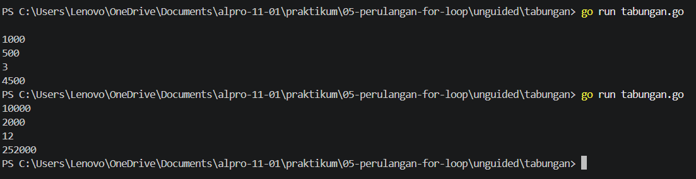
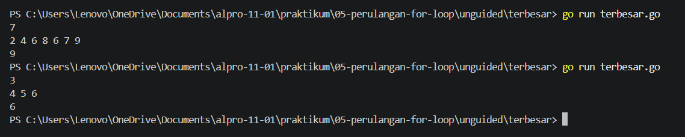

[text](laprak_Modul00.md)# <h1 align="center">Laporan Praktikum Modul 05 - "PERULANGAN FOR"</h1>
<p align="center">[Yahya al wahab] - [109092600004]</p>

## Dasar Teori

### A. Perulangan For
Perulangan for memiliki tiga bagian utama, yaitu inisialisasi untuk menentukan nilai awal, kondisi untuk menentukan kapan perulangan berhenti, dan perubahan nilai untuk mengatur setiap pengulangan. Dengan menggunakan for, program menjadi lebih sederhana karena tidak perlu menulis perintah yang sama berulang kali.

### B. For hanya kondisi
Perulangan for dengan kondisi digunakan untuk menjalankan perintah secara berulang selama kondisi bernilai true. Perulangan akan berhenti ketika kondisi bernilai false.


## Guided

### 1. tabungan.go

```go
import "fmt"

func main(){
	var a, b, n int

	fmt.Scan(&a, &b, &n)

	total := 0
	tabunganHariIni := a

	for i := 1; i <= n; i++{
		total = total + tabunganHariIni
		tabunganHariIni = tabunganHariIni + b
	}

	fmt.Println(total)
}
```
#### Deskripsi
Program ini menghitung total tabungan selama n hari. Perulangan for berjalan selama kondisi i <= n bernilai benar. Setiap pengulangan, tabungan hari ini ditambahkan ke total, lalu jumlah tabungan harian bertambah sebesar b. Setelah perulangan selesai, program menampilkan total seluruh tabungan.

### 2. terbesar.go

```go
package main

import "fmt"

func main() {
	var n, bilangan, terbesar int
	fmt.Scan(&n)

	for i := 1; i <= n; i++ {
		fmt.Scan(&bilangan)

		if i == 1 || bilangan > terbesar {
			terbesar = bilangan
		}
	}

	fmt.Println(terbesar)
}
```
#### Deskripsi
Program ini digunakan untuk mencari bilangan terbesar dari sejumlah bilangan yang dimasukkan. Perulangan for berjalan sebanyak n kali untuk membaca setiap bilangan. Jika bilangan yang dimasukkan lebih besar dari nilai terbesar, maka nilai terbesar akan diperbarui. Setelah perulangan selesai, program menampilkan bilangan terbesar.

### 3. bioskop.go

```go
package main

import "fmt"

func main(){
	var t int
	fmt.Print("input t (jumlah transaksi): ")
	fmt.Scan(&t)

	totalPendapatan := 0

	for i := 1; i <= t; i++ {
		var jenisFilm, hari string
		var jumlahTiket int

		fmt.Printf("input transaksi ke-%d (jenis, hari, tiket): ", i)
		fmt.Scan(&jenisFilm, &hari, &jumlahTiket)

		hargaSatuan := 0

		if jenisFilm == "Reguler" {
			if hari == "Senin" || hari == "Selasa" || hari == "Rabu" || hari == "Kamis" {
				hargaSatuan = 40000
			} else {
				hargaSatuan = 50000
			}
		} else if jenisFilm == "3D" {
			if hari == "Senin" || hari == "Selasa" || hari == "Rabu" || hari == "Kamis" {
				hargaSatuan = 60000
			} else {
				hargaSatuan = 70000
			}
		} else if jenisFilm =="IMAX" {
			if hari == "Senin" || hari == "Selasa" || hari == "Rabu" || hari == "Kamis" {
				hargaSatuan = 80000
			} else {
				hargaSatuan = 90000
			}
		}

		totalHarga := hargaSatuan * jumlahTiket

		if jumlahTiket >= 5 {
			diskon := (totalHarga * 10) / 100
			totalHarga = totalHarga - diskon
		}

		fmt.Printf("output total harga transaksi ke-%d: %d\n", i, totalHarga)

		totalPendapatan = totalPendapatan + totalHarga
	}

	fmt.Println("output total pendapatan:", totalPendapatan)
}
```
#### Deskripsi
Program ini menghitung total harga tiket bioskop berdasarkan jenis film, hari pemutaran, dan jumlah tiket. Perulangan for digunakan untuk memproses setiap transaksi sesuai jumlah yang dimasukkan. Harga tiket ditentukan menggunakan if else, kemudian diskon 10% diberikan jika membeli minimal 5 tiket. Setelah itu, total harga setiap transaksi dijumlahkan untuk mendapatkan total pendapatan bioskop.
	
## Unguided

### 1. tabungan.go

```go
package main

import "fmt"

func main() {
	var a, b, n int
	fmt.Scan(&a, &b, &n)

	total := 0;
	tabunganHariIni := a;

	for i := 1; i <= n; i++ {
		total = total + tabunganHariIni
		tabunganHariIni = tabunganHariIni + b
	}
	fmt.Println(total)
}
```
##### Output
<!-- Path relatif dari readme.md ke folder unguided/[nama_soal]/output.png, contoh: -->


#### Deskripsi
Program ini menghitung total tabungan selama n hari, dimulai dari tabungan awal sebesar a dan bertambah b setiap hari. Perulangan for digunakan untuk menjumlahkan tabungan setiap hari hingga mencapai hari ke-n. Setelah perulangan selesai, program menampilkan total seluruh tabungan.


### 2. terbesar.go

```go
package main

import "fmt"

func main() {
	var n int
	fmt.Scan(&n)

	var angka, max int
	fmt.Scan(&angka)
	max = angka

	for i := 2; i <= n; i++ {
		fmt.Scan(&angka)

		if angka > max {
			max = angka
		}
	}

	fmt.Println(max)
}
```

##### Output


#### Deskripsi
Program ini digunakan untuk mencari bilangan terbesar dari sejumlah bilangan yang dimasukkan. Bilangan pertama disimpan sebagai nilai awal max. Perulangan for digunakan untuk membaca bilangan berikutnya, lalu membandingkannya dengan nilai max. Jika bilangan lebih besar, nilai max diperbarui. Setelah perulangan selesai, program menampilkan bilangan terbesar.

<!-- Duplikasi blok "### [nama_soal]" sesuai jumlah folder soal di dalam unguided -->


## Kesimpulan
Perulangan for dalam bahasa Go digunakan untuk menjalankan perintah secara berulang sesuai kondisi yang ditentukan. Perulangan ini dapat digunakan untuk menghitung total tabungan, mencari bilangan terbesar, dan memproses transaksi. Dengan menggunakan for, program menjadi lebih sederhana, terstruktur, dan efisien.

## Referensi
1. The Go Authors. (2024). The Go Programming Language Specification: For statements. https://go.dev/ref/spec#For_statements
2. The Go Authors. (2024). A Tour of Go: For. https://go.dev/tour/flowcontrol/1