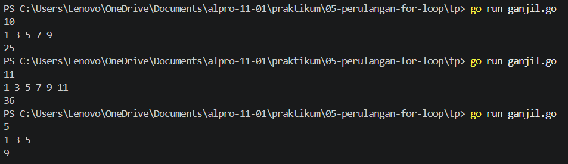
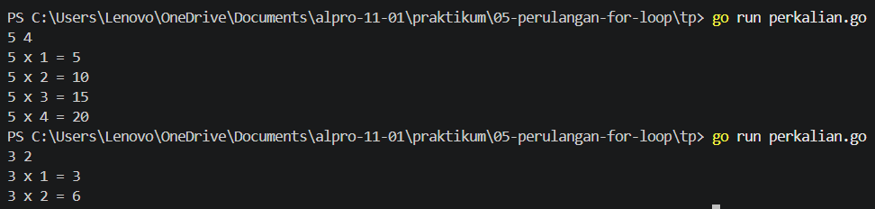

# <h1 align="center">Tugas Pendahuluan Modul 05 - Perulangan For Loop </h1>
<p align="center">[Yahya al wahab] - [109092600004]</p>

### 1. ganjil.go

```go
package main

import "fmt"

func main() {
	var n, jumlah int
	fmt.Scan(&n)

	jumlah = 0
	for i := 1; i <= n; i += 2 {
		fmt.Print(i, " ")
		jumlah += i
	}

	fmt.Println()
	fmt.Println(jumlah)
}
```

##### Output
<!-- Path relatif dari readme.md ke folder unguided/[nama_soal]/output.png, contoh: -->



#### Deskripsi
Program ini digunakan untuk menampilkan bilangan ganjil dari 1 sampai n menggunakan perulangan for. Setiap bilangan ganjil yang ditampilkan akan dijumlahkan dan hasil akhirnya dicetak setelah perulangan selesai.


### 2. perkalian.go

```go
package main

import "fmt"

func main(){
	var a, b int
	fmt.Scan(&a, &b)

	for i := 1; i <= b; i++ {
		fmt.Println(a, "x", i, "=", a*i)
	}
}
```

##### Output
<!-- Path relatif dari readme.md ke folder unguided/[nama_soal]/output.png, contoh: -->



#### Deskripsi
Program ini digunakan untuk menampilkan tabel perkalian dari bilangan `a` mulai dari `a × 1` hingga `a × b`. Program menggunakan perulangan `for` untuk menghitung dan menampilkan hasil perkalian pada setiap baris.


### 3. fungsi.md

```go
1. Fungsi utama perulangan `for`
   Perulangan for dalam bahasa Go berfungsi untuk menjalankan suatu blok kode secara berulang selama kondisi yang ditentukan masih bernilai true.
2. Tiga komponen pada perulangan `for`
   1. Inisialisasi: Digunakan untuk menentukan nilai awal variabel yang menjadi penghitung perulangan. Contoh: i := 1.
   2. Kondisi: Digunakan untuk menentukan apakah perulangan akan terus berjalan atau berhenti. Contoh: i <= 5.
   3. Post statement: Digunakan untuk mengubah nilai variabel setelah setiap perulangan, biasanya dengan menambah atau mengurangi nilainya. Contoh: i++.
```
### 4. while_do-while.md

```go
1. For dengan tiga komponen.
   Perulangan for dengan tiga komponen memiliki inisialisasi, kondisi, dan post statement. Biasanya digunakan ketika jumlah perulangan sudah diketahui.

   contoh kode:
   for i := 1; i <= 5; i++ {
    fmt.Println(i)
}
   penjelasan:
   i := 1 sebagai nilai awal.
   i <= 5 sebagai kondisi perulangan.
   i++ untuk menambah nilai i setiap perulangan.

2. For yang hanya menggunakan kondisi.
   Perulangan for yang hanya menggunakan kondisi bekerja seperti while pada bahasa pemrograman lain. Perulangan akan terus berjalan selama kondisi bernilai true.

   contoh kode:
   i := 1
for i <= 5 {
    fmt.Println(i)
    i++
}
    penjelasan:
    i := 1 menentukan nilai awal di luar perulangan.
    i <= 5 menjadi kondisi perulangan.
    i++ menambah nilai i di dalam blok kode.
```


## Kesimpulan
Berdasarkan kedua kode tersebut, perulangan for dalam bahasa Go digunakan untuk menjalankan perintah secara berulang. Kode pertama menampilkan bilangan ganjil sekaligus menghitung jumlahnya, sedangkan kode kedua menampilkan tabel perkalian dari bilangan a hingga a × b. Perulangan for dapat menggunakan inisialisasi, kondisi, dan post statement untuk mengatur jalannya perulangan sehingga program menjadi lebih sederhana dan efisien.