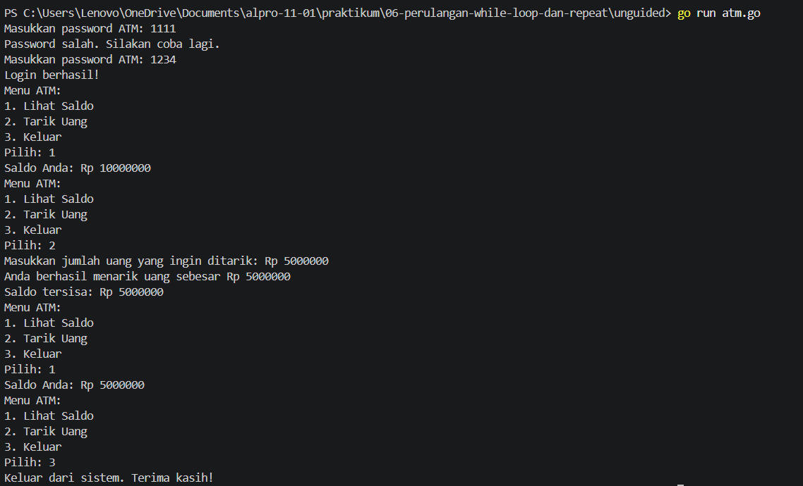

[text](laprak_Modul00.md)# <h1 align="center">Laporan Praktikum Modul 06 - "PERULANGAN WHILE"</h1>
<p align="center">[Yahya al wahab] - [109092600004]</p>

## Dasar Teori

### A. Perulangan While pada Golang
Perulangan while adalah struktur perulangan yang digunakan untuk menjalankan perintah secara berulang selama kondisi yang ditentukan bernilai benar (true). Dalam bahasa Go, tidak terdapat perintah while secara langsung, sehingga digunakan for dengan kondisi untuk menghasilkan cara kerja yang sama. Program akan memeriksa kondisi terlebih dahulu sebelum menjalankan perintah di dalam perulangan. Jika kondisi masih benar, perintah akan terus dijalankan hingga kondisi bernilai salah (false). Agar perulangan dapat berhenti dengan tepat, diperlukan perubahan nilai variabel atau kondisi yang sesuai. Perulangan ini dapat digunakan dalam berbagai program, seperti proses login, validasi input, dan menu ATM yang terus ditampilkan sampai pengguna memilih untuk keluar.

### B. Karakteristik Perulangan While pada Golang
Perulangan while merupakan struktur perulangan yang menjalankan instruksi secara berulang selama kondisi yang ditentukan masih bernilai benar (true). Dalam bahasa Go, perulangan ini menggunakan for dengan kondisi karena Go tidak menyediakan kata kunci while secara khusus. Kondisi diperiksa sebelum instruksi dijalankan, sehingga apabila kondisi bernilai salah (false) sejak awal, instruksi di dalam perulangan tidak akan dijalankan. Penggunaan perulangan ini memerlukan pengaturan kondisi yang tepat agar proses pengulangan dapat berhenti sesuai kebutuhan dan tidak menyebabkan perulangan tanpa akhir (infinite loop).


## Guided

### 1. terkecil.go

```go
package main

import "fmt"

func main() {
    var batas int
    fmt.Scan(&batas)

    n := 1
    for n*n*n <= batas {
        n++
    }

    fmt.Println(n)
}
```
#### Deskripsi
Program ini digunakan untuk mencari bilangan terkecil yang pangkat tiganya lebih besar dari nilai batas yang dimasukkan. Program menggunakan perulangan for untuk menaikkan nilai n sampai kondisi tidak terpenuhi, lalu menampilkan hasilnya.

### 2. terbesar.go

```go
package main

import "fmt"

func main() {
    var batas int
    fmt.Scan(&batas)

    n := 1
    for n*n < batas {
        n++
    }

    fmt.Println(n - 1)
}
```
#### Deskripsi
Program ini digunakan untuk mencari bilangan bulat positif terbesar yang kuadratnya lebih kecil dari nilai batas yang dimasukkan pengguna. Program menggunakan perulangan for untuk menaikkan nilai n hingga kondisi tidak terpenuhi, kemudian menampilkan hasilnya dengan mengurangi nilai n sebanyak 1.

### 3.vokal.go

```go
package main

import (
    "bufio"
    "fmt"
    "os"
    "strings"
)

func main() {
    reader := bufio.NewReader(os.Stdin)
    kalimat, _ := reader.ReadString('\n')

    i := 0
    jumlahVokal := 0

    for i < len(kalimat) {
        ch := strings.ToLower(string(kalimat[i]))
        if ch == "a" || ch == "i" || ch == "u" || ch == "e" || ch == "o" {
            jumlahVokal++
        }
        i++
    }

    fmt.Println(jumlahVokal)
}
```
#### Deskripsi
Program ini digunakan untuk menghitung jumlah huruf vokal (a, i, u, e, o) dalam sebuah kalimat yang dimasukkan oleh pengguna. Program membaca kalimat menggunakan bufio.NewReader, kemudian memeriksa setiap karakter dengan perulangan for. Fungsi strings.ToLower digunakan untuk mengubah karakter menjadi huruf kecil agar huruf vokal besar dan kecil dapat dihitung. Setiap ditemukan huruf vokal, variabel jumlahVokal bertambah satu, lalu hasil akhirnya ditampilkan ke layar.
	
## Unguided

### 1. atm.go

```go
package main

import "fmt"

func main() {
	var password string
	var percobaan int
	var saldo int = 10000000
	var pilihan int

	// Proses login
	percobaan = 0

	for password != "1234" && percobaan < 3 {
		fmt.Print("Masukkan password ATM: ")
		fmt.Scan(&password)

		percobaan++

		if password != "1234" {
			fmt.Println("Password salah. Silakan coba lagi.")
		}
	}

	if password != "1234" {
		fmt.Println("ATM terblokir. Program selesai.")
		return
	}

	fmt.Println("Login berhasil!")

	// Menu ATM
	pilihan = 0

	for pilihan != 3 {
		fmt.Println("Menu ATM:")
		fmt.Println("1. Lihat Saldo")
		fmt.Println("2. Tarik Uang")
		fmt.Println("3. Keluar")
		fmt.Print("Pilih: ")
		fmt.Scan(&pilihan)

		if pilihan == 1 {
			fmt.Printf("Saldo Anda: Rp %d\n", saldo)
		} else if pilihan == 2 {
			var tarik int

			fmt.Print("Masukkan jumlah uang yang ingin ditarik: Rp ")
			fmt.Scan(&tarik)

			if tarik <= 0 {
				fmt.Println("Jumlah penarikan tidak valid.")
			} else if tarik <= saldo {
				saldo -= tarik
				fmt.Printf("Anda berhasil menarik uang sebesar Rp %d\n", tarik)
				fmt.Printf("Saldo tersisa: Rp %d\n", saldo)
			} else {
				fmt.Println("Saldo tidak mencukupi.")
			}
		} else if pilihan == 3 {
			fmt.Println("Keluar dari sistem. Terima kasih!")
		} else {
			fmt.Println("Pilihan tidak valid.")
		}
	}
}
```
##### Output
<!-- Path relatif dari readme.md ke folder unguided/[nama_soal]/output.png, contoh: -->


#### Deskripsi
Program ini dibuat menggunakan bahasa Go untuk menyimulasikan sistem ATM. Pengguna harus memasukkan password yang benar dalam maksimal tiga kali percobaan untuk masuk ke sistem. Setelah berhasil login, pengguna dapat memilih menu untuk melihat saldo, menarik uang, atau keluar dari program. Perulangan for digunakan untuk proses login dan menampilkan menu secara berulang, sedangkan percabangan if-else digunakan untuk memproses pilihan pengguna. Saldo awal sebesar Rp10.000.000 akan berkurang sesuai jumlah uang yang ditarik jika saldo mencukupi. Jika password salah sebanyak tiga kali, ATM akan terblokir dan program berakhir.

<!-- Duplikasi blok "### [nama_soal]" sesuai jumlah folder soal di dalam unguided -->


## Kesimpulan
perulangan while dalam bahasa Go dapat diterapkan menggunakan for dengan kondisi. Perulangan ini digunakan untuk menjalankan perintah secara berulang selama kondisi masih terpenuhi. Pada program yang telah dibuat, perulangan digunakan untuk mencari bilangan berdasarkan kuadrat dan pangkat tiga, menghitung jumlah huruf vokal dalam kalimat, serta menjalankan proses login dan menu ATM. Dengan menggunakan perulangan dan percabangan `if-else`, program dapat berjalan secara terstruktur, memeriksa kondisi, memproses input pengguna, dan menentukan kapan perulangan harus berhenti.

## Referensi
1. The Go Authors. (2026). The Go Programming Language Specification — For statements. Go.dev.
Link: https://go.dev/ref/spec#For_statements