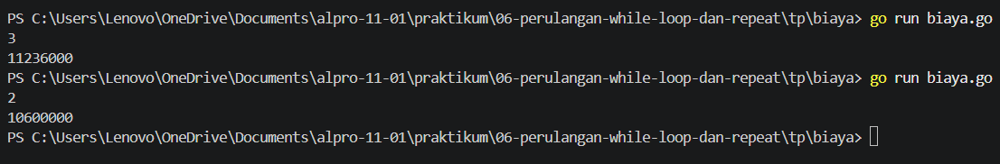
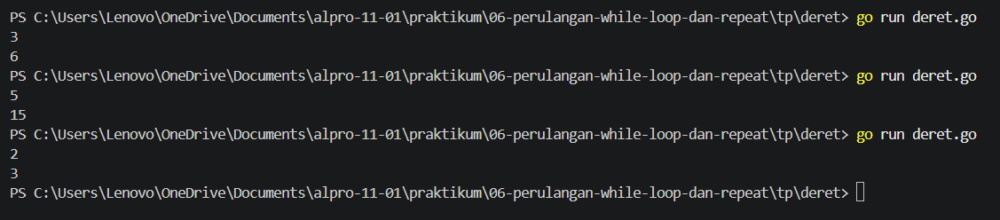
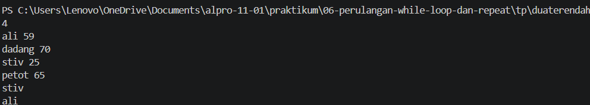
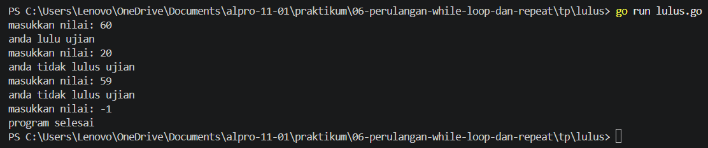

# <h1 align="center">Tugas Pendahuluan Modul 06 - Perulangan While </h1>
<p align="center">[Yahya al wahab] - [109092600004]</p>

### 1. biaya.go

```go
package main 

import "fmt"

func main(){
	var n int
	var biaya float64 = 10000000

	fmt.Scan(&n)

	for i := 2; i <= n; i++ {
		biaya = biaya * 1.06
	}

	fmt.Printf("%.0f\n", biaya)
}
```

##### Output
<!-- Path relatif dari readme.md ke folder unguided/[nama_soal]/output.png, contoh: -->



#### Deskripsi
Program ini digunakan untuk menghitung perkiraan biaya kuliah pada tahun ke-n. Biaya awal kuliah sebesar Rp10.000.000 dan meningkat sebesar 6% setiap tahun. Program menggunakan tipe data float64 untuk menyimpan biaya dan perulangan for untuk menghitung kenaikan biaya setiap tahun. Hasil perhitungan ditampilkan dalam bentuk bilangan bulat yang dibulatkan ke rupiah terdekat menggunakan `fmt.Printf("%.0f\n", biaya)`.

### 2. deret.go

```go
package main

import "fmt"

func main(){
	var n, i, total int
	fmt.Scan(&n)

	i = 1
	for i <= n {
		total += i
		i++
	}
	fmt.Println(total)
}
```

##### Output
<!-- Path relatif dari readme.md ke folder unguided/[nama_soal]/output.png, contoh: -->



#### Deskripsi
Program ini digunakan untuk menghitung hasil penjumlahan bilangan dari 1 sampai angka yang dimasukkan oleh pengguna. Proses penjumlahan dilakukan secara berulang hingga mencapai angka yang ditentukan. Setelah semua bilangan dijumlahkan, hasil akhirnya akan ditampilkan ke layar.

### 3. duaterendah.go

```go
package main

import "fmt"

func main(){
	var n, nilai int
	var nama string
	var terendah, kedua int
	var namaTerendah, namaKedua string

	fmt.Scan(&n)

	i := 1
	for i <= n {
		fmt.Scan(&nama, &nilai)

		if i == 1 {
			terendah = nilai
			kedua = nilai
			namaTerendah = nama
			namaKedua = nama
		} else if nilai < terendah {
			kedua = terendah
			namaKedua = namaTerendah
			terendah = nilai
			namaTerendah = nama
		} else if i == 2 || nilai < kedua {
			kedua = nilai
			namaKedua = nama
		}

		i++
	}

	fmt.Println(namaTerendah)
	fmt.Println(namaKedua)
	
}
```

##### Output
<!-- Path relatif dari readme.md ke folder unguided/[nama_soal]/output.png, contoh: -->



#### Deskripsi
Program ini digunakan untuk mencari dua siswa dengan nilai terendah dari sejumlah siswa yang dimasukkan. Pengguna memasukkan jumlah siswa, nama, dan nilai masing-masing siswa. Program kemudian membandingkan nilai setiap siswa untuk menentukan nilai terendah dan nilai kedua terendah. Setelah semua data siswa selesai diperiksa, nama kedua siswa tersebut akan ditampilkan ke layar.

### 4. lulus.go

```go
package main 

import "fmt"

func main(){
	var nilai int

	for {
		fmt.Print("masukkan nilai: ")
		fmt.Scan(&nilai)

		if nilai == -1 {
			fmt.Println("program selesai")
			break
		}

		if nilai >= 60 {
			fmt.Println("anda lulu ujian")
		} else {
			fmt.Println("anda tidak lulus ujian")
		}
	}
}
```

##### Output
<!-- Path relatif dari readme.md ke folder unguided/[nama_soal]/output.png, contoh: -->



#### Deskripsi
Program ini digunakan untuk menentukan apakah siswa lulus atau tidak berdasarkan nilai ujian yang dimasukkan. Pengguna dapat memasukkan nilai secara berulang, lalu program akan menampilkan pesan lulus jika nilai lebih besar atau sama dengan 60, dan tidak lulus jika nilai kurang dari 60. Program menggunakan perulangan for agar pengguna dapat memasukkan nilai berkali-kali. Jika pengguna memasukkan nilai -1, program akan berhenti dan menampilkan pesan bahwa program selesai.


## Kesimpulan
Perulangan for dalam bahasa Go dapat digunakan untuk menjalankan perintah secara berulang sesuai kondisi yang ditentukan. Dengan perulangan ini, program dapat memproses input berkali-kali dan menggunakan percabangan if-else untuk menentukan hasil. Perintah break digunakan untuk menghentikan perulangan ketika kondisi tertentu terpenuhi, sehingga program menjadi lebih efektif dan mudah digunakan.