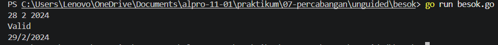
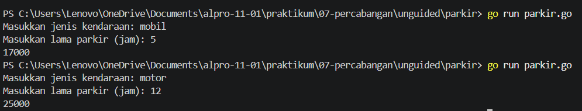

# <h1 align="center">Laporan Praktikum Modul 07 - “PERCABANGAN”</h1>
<p align="center">[Yahya al wahab] - [109092600004]</p>

## Dasar Teori

### A. Percabangan If
Percabangan `if` dalam bahasa Go adalah struktur kontrol yang digunakan untuk menjalankan suatu perintah jika kondisi yang ditentukan bernilai benar `(true)`. Jika kondisi bernilai salah `(false)`, perintah di dalam blok `if` tidak akan dijalankan.

### B. Switch 
Percabangan `switch` dalam bahasa Go adalah struktur kontrol yang digunakan untuk memilih dan menjalankan perintah berdasarkan nilai atau kondisi yang sesuai. switch dapat menjadi alternatif dari banyak percabangan `if-else`, sehingga kode program lebih sederhana dan mudah dipahami.

## Guided

### 1. kabisat.go

```go
package main

import "fmt"

func main(){
	var tahun int
	fmt.Scan(&tahun)

	if (tahun%4 == 0 && tahun%100 != 0) ||  (tahun%400 == 0) {
		fmt.Println("Ya")
	} else {
		fmt.Println("Tidak")
	}
}
```

#### Deskripsi
Program ini dibuat untuk menentukan apakah suatu tahun termasuk tahun kabisat atau bukan. Program menerima input berupa tahun, kemudian menggunakan percabangan `if-else` dan operator logika untuk memeriksa aturan tahun kabisat. Tahun termasuk kabisat jika habis dibagi 4 tetapi tidak habis dibagi 100, atau habis dibagi 400. Jika memenuhi kondisi tersebut, program menampilkan "Ya". Jika tidak, program menampilkan "Tidak".

### 2. segitiga.go

```go
package main

import "fmt"

func main() {
	var a, b, c int
	fmt.Scan(&a, &b, &c)

	if a <= 0 || b <= 0 || c <= 0 || a+b <= c || a+c <= b || b+c <= a {
		fmt.Println("Bukan segitiga")
	} else if a == b && b == c {
		fmt.Println("Segitiga sama sisi")
	} else if a == b || a == c || b == c {
		fmt.Println("Segitiga sama kaki")
	} else {
		fmt.Println("Segitiga sembarang")
	}
}
```

#### Deskripsi
Program ini dibuat untuk menentukan jenis segitiga berdasarkan panjang ketiga sisinya. Program menerima tiga bilangan bulat, yaitu `a, b, dan c`, kemudian menggunakan percabangan `if-else` serta operator perbandingan dan logika untuk memeriksa apakah ketiga sisi dapat membentuk segitiga. Jika syarat segitiga tidak terpenuhi, program menampilkan "Bukan segitiga". Jika semua sisi sama panjang, program menampilkan "Segitiga sama sisi". Jika dua sisi sama panjang, program menampilkan "Segitiga sama kaki". Jika semua sisi berbeda panjang, program menampilkan "Segitiga sembarang".

### 3. kalkulator.go

```go
package main

import "fmt"

func main() {
	var a, b int
	var op string

	fmt.Scan(&a, &op, &b)

	switch op {
	case "+":
		fmt.Println(a + b)
	case "-":
		fmt.Println(a - b)
	case "*":
		fmt.Println(a * b)
	case "/":
		if b == 0 {
			fmt.Println("Error: pembagian dengan nol")
		} else {
			fmt.Printf("%.2f\n", float64(a)/float64(b))
		}
	case "%":
		if b == 0 {
			fmt.Println("Error: pembagian dengan nol")
		} else {
			fmt.Println(a % b)
		}
	default:
		fmt.Println("Error: operator tidak valid")
	}
}
```

#### Deskripsi
Program ini dibuat untuk melakukan operasi aritmetika sederhana berdasarkan dua bilangan dan operator yang dimasukkan oleh pengguna. Program menggunakan percabangan switch-case untuk menentukan operasi penjumlahan, pengurangan, perkalian, pembagian, atau modulo. Pada operasi pembagian dan modulo, program memeriksa apakah bilangan kedua bernilai nol untuk menghindari kesalahan. Jika operator yang dimasukkan tidak sesuai, program akan menampilkan pesan bahwa operator tidak valid.

### 4. ongkir.go

```go
package main

import (
	"fmt"
	"math"
)

func main() {
	var berat float64
	var zona int
	var layanan string
	fmt.Scan(&berat, &zona, &layanan)

	if berat > 30 {
		fmt.Println("Berat melebihi batas maksimal (30 kg)")
		return
	}

	var tarifPerKg int

	switch zona {
	case 1:
		tarifPerKg = 10000
	case 2:
		tarifPerKg = 15000
	case 3:
		tarifPerKg = 20000
	default:
		fmt.Println("Zona tidak valid")
		return
	}

	beratBulat := int(math.Ceil(berat))
	total := beratBulat * tarifPerKg

	if layanan == "Express" {
		total += total / 2
	} else if layanan != "Reguler" {
		fmt.Println("Layanan tidak tersedia")
		return
	}

	fmt.Println(beratBulat)
	fmt.Println(total)
}
```

#### Deskripsi
Program ini dibuat untuk menghitung biaya pengiriman barang berdasarkan berat, zona pengiriman, dan jenis layanan yang dipilih. Program menggunakan percabangan if-else untuk memeriksa batas maksimal berat dan jenis layanan, serta switch-case untuk menentukan tarif berdasarkan zona pengiriman. Berat barang dibulatkan ke atas menggunakan math.Ceil, kemudian dikalikan dengan tarif per kilogram. Jika menggunakan layanan Express, biaya ditambah 50% dari total biaya awal. Program juga menampilkan pesan kesalahan jika berat melebihi 30 kg, zona tidak valid, atau layanan tidak tersedia.

## Unguided

### 1. besok.go

```go
package main

import "fmt"

func main() {
	var tanggal, bulan, tahun int
	fmt.Scan(&tanggal, &bulan, &tahun)

	kabisat := (tahun%4 == 0 && tahun%100 != 0) || (tahun%400 == 0)

	hariBulan := 0
	switch bulan {
	case 1, 3, 5, 7, 8, 10, 12:
		hariBulan = 31
	case 4, 6, 9, 11:
		hariBulan = 30
	case 2:
		if kabisat {
			hariBulan = 29
		} else {
			hariBulan = 28
		}
	}

	if tanggal < 1 || tanggal > hariBulan {
		fmt.Println("Tidak valid")
		return
	}

	tanggal++
	if tanggal > hariBulan {
		tanggal = 1
		bulan++
		if bulan > 12 {
			bulan = 1
			tahun++
		}
	}

	fmt.Println("Valid")
	fmt.Printf("%d/%d/%d\n", tanggal, bulan, tahun)
}
```

##### Output


#### Deskripsi
Program ini dibuat untuk memeriksa validitas tanggal dan menentukan tanggal berikutnya berdasarkan tanggal, bulan, dan tahun yang dimasukkan oleh pengguna. Program menggunakan variabel kabisat untuk menentukan apakah tahun termasuk tahun kabisat, serta percabangan `switch-case` untuk menentukan jumlah hari dalam setiap bulan. Percabangan `if-else` digunakan untuk memeriksa apakah tanggal valid dan mengatur perubahan tanggal, bulan, serta tahun jika melewati batas akhir bulan atau akhir tahun. Jika tanggal tidak valid, program menampilkan "Tidak valid". Jika tanggal valid, program menampilkan "Valid" beserta tanggal berikutnya.

### 2. parkir.go

NIM saya 109092600004 mod 3 = 1, jadi soal yang dikerjakan adalah Soal A

```go
package main

import "fmt"

func main() {
	var jenis string
	var jam int
	var tarif int
	var denda int = 0

	fmt.Print("Masukkan jenis kendaraan: ")
	fmt.Scan(&jenis)

	fmt.Print("Masukkan lama parkir (jam): ")
	fmt.Scan(&jam)

	if jenis == "Mobil" || jenis == "mobil" {
		if jam <= 1 {
			tarif = 5000
		} else {
			tarif = 5000 + (jam-1)*3000
		}

		if jam > 24 {
			denda = 50000
		}
	} else if jenis == "Motor" || jenis == "motor" {
		if jam <= 1 {
			tarif = 3000
		} else {
			tarif = 3000 + (jam-1)*2000
		}

		if jam > 24 {
			denda = 30000
		}
	} else {
		fmt.Println("Jenis kendaraan tidak valid")
		return
	}

	fmt.Println(tarif + denda)
}
```

##### Output


#### Deskripsi
Program parkir.go dibuat untuk menghitung biaya parkir berdasarkan jenis kendaraan dan lama parkir. Tarif parkir mobil adalah Rp5.000 untuk jam pertama dan Rp3.000 untuk setiap jam berikutnya, sedangkan motor dikenakan Rp3.000 untuk jam pertama dan Rp2.000 untuk setiap jam berikutnya. Jika lama parkir lebih dari 24 jam, akan dikenakan denda tambahan sesuai jenis kendaraan. Program menggunakan percabangan if-else untuk menentukan tarif dan denda, kemudian menampilkan total biaya parkir yang harus dibayar.

## Kesimpulan
Percabangan membantu program menentukan tindakan berdasarkan kondisi. `if-else` cocok untuk memeriksa berbagai syarat, sedangkan `switch` digunakan untuk memilih berdasarkan nilai tertentu. Urutan pemeriksaan kondisi juga memengaruhi hasil program

## Referensi
1. The Go Authors. (2024). *The Go Programming Language Specification*. https://go.dev/ref/spec
2. Donovan, A. A., & Kernighan, B. W. (2015). *The Go Programming Language*. New York: Addison-Wesley
3. Laboratorium Praktikum Informatika. (2025). *Modul 07: Percabangan - Algoritma dan Pemrograman*. Bandung: Fakultas Informatika, Universitas Telkom