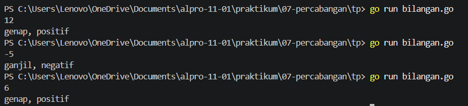
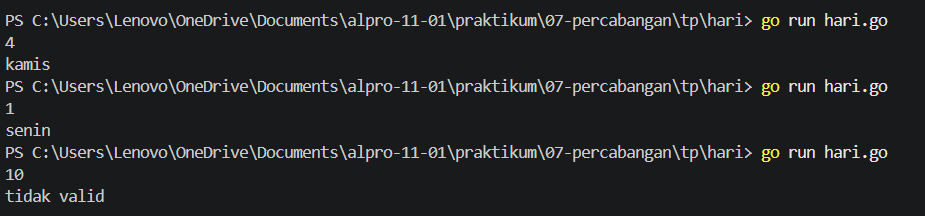
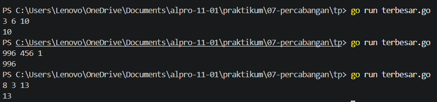

# <h1 align="center">Tugas Pendahuluan Modul 07 - Percabangan </h1>
<p align="center">[Yahya al wahab] - [109092600004]</p>

### 1. perbedaan.md
```go
1. if
Digunakan untuk menjalankan kode jika suatu kondisi bernilai benar (true). Jika kondisi salah, kode di dalam if tidak dijalankan.

2. if-else
Digunakan untuk memilih salah satu dari dua kemungkinan. Jika kondisi if benar, blok if dijalankan. Jika salah, blok else dijalankan.

3. else-if
Digunakan untuk memeriksa beberapa kondisi secara berurutan. Kondisi diperiksa dari atas ke bawah, dan blok pertama yang kondisinya benar akan dijalankan.

4. switch
Digunakan untuk memilih tindakan berdasarkan nilai atau kondisi tertentu. switch dapat menjadi alternatif dari banyak percabangan if-else, terutama ketika membandingkan satu nilai dengan beberapa pilihan.

5. 2 perbedaan `switch` pada Go dan Java
    Go
    1. Tidak memerlukan kata kunci `break`pada setiap `case` karena secara default eksekusi berhenti setelah satu kasus yang cocok selesai.
    2. `switch` dapat di gunakan tanpa ekspresi, sehingga setiap `case` bisa berisi kondisi boolean.

    Java
    1. Pada bentuk `switch` klasik, `break` biasanya diperlukan agar eksekusi tidak berlanjut ke `case` berikutnya (fall-through).
    2. Pada `switch` klasik, setiap `case` umumnya berisi nilai atau label yang dibandingkan dengan ekspresi`switch`, bukan kondisi boolean bebas.
```

### 2. bilangan.go

```go
package main

import "fmt"

func main(){
	var n int
	fmt.Scan(&n)

	if n%2 == 0 {
		fmt.Print("genap, ")
	} else {
		fmt.Print("ganjil, ")
	}

	if n > 0 {
		fmt.Println("positif")
	} else if n < 0 {
		fmt.Println("negatif")
	} else {
		fmt.Println("nol")
	}
}
```

##### Output
<!-- Path relatif dari readme.md ke folder unguided/[nama_soal]/output.png, contoh: -->



#### Deskripsi
Program ini dibuat untuk menentukan jenis bilangan berdasarkan sifat genap atau ganjil serta nilainya, yaitu positif, negatif, atau nol. Program menerima satu bilangan bulat sebagai input, kemudian menggunakan percabangan `if-else` dan operator modulo `(%)` untuk memeriksa apakah bilangan tersebut genap atau ganjil. Selanjutnya, program memeriksa apakah bilangan bernilai positif, negatif, atau nol, lalu menampilkan hasilnya ke layar.

### 3. hari.go

```go
package main

import "fmt"

func main(){
	var hari int
	fmt.Scan(&hari)

	switch hari {
	case 1:
		fmt.Println("senin")
	case 2:
		fmt.Println("selasa")
	case 3:
		fmt.Println("rabu")
	case 4:
		fmt.Println("kamis")
	case 5:
		fmt.Println("jum'at")
	case 6:
		fmt.Println("sabtu")
	case 7:
		fmt.Println("minggu")
	default:
		fmt.Println("tidak valid")
	}
}
```

##### Output
<!-- Path relatif dari readme.md ke folder unguided/[nama_soal]/output.png, contoh: -->



#### Deskripsi
Program ini dibuat untuk menentukan nama hari berdasarkan angka yang dimasukkan oleh pengguna. Program menerima input berupa bilangan bulat dari 1 sampai 7, kemudian menggunakan percabangan `switch-case` untuk mencocokkan angka dengan nama hari yang sesuai. Angka 1 menunjukkan Senin, angka 2 menunjukkan Selasa, dan seterusnya hingga angka 7 menunjukkan Minggu. Jika angka yang dimasukkan berada di luar rentang 1 sampai 7, program akan menampilkan pesan "tidak valid".

### 4. terbesar.go

```go
package main

import "fmt"

func main(){
	var a, b, c int
	fmt.Scan(&a, &b, &c)

	if a >= b && a >= c {
		fmt.Println(a)
	} else if b >= a && b >= c {
		fmt.Println(b)
	} else {
		fmt.Println(c)
	}
}
```

##### Output
<!-- Path relatif dari readme.md ke folder unguided/[nama_soal]/output.png, contoh: -->



#### Deskripsi
Program ini dibuat untuk menentukan bilangan terbesar dari tiga bilangan bulat yang dimasukkan oleh pengguna. Program menerima tiga input, yaitu a, b, dan c, kemudian menggunakan percabangan `if-else` serta operator perbandingan (>=) dan logika (&&) untuk membandingkan ketiga bilangan tersebut. Setelah perbandingan dilakukan, program menampilkan bilangan terbesar ke layar. Program juga dapat menangani bilangan negatif maupun bilangan yang memiliki nilai sama.


## Kesimpulan
Berdasarkan praktikum yang telah dilakukan, dapat disimpulkan bahwa percabangan dalam bahasa Go digunakan untuk menentukan tindakan berdasarkan kondisi tertentu. Percabangan if, if-else, dan else-if digunakan untuk memeriksa kondisi, sedangkan switch digunakan untuk memilih tindakan berdasarkan nilai yang sesuai. Melalui program bilangan.go, hari.go, dan terbesar.go, dapat dipahami cara menggunakan percabangan untuk menentukan jenis bilangan, nama hari, dan bilangan terbesar dari tiga angka. Dengan memahami percabangan, program dapat dibuat lebih terstruktur dan mampu menghasilkan keluaran sesuai dengan kondisi yang diberikan.