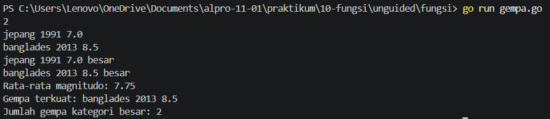
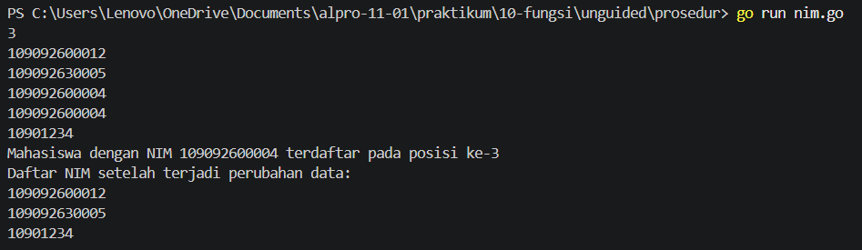

# <h1 align="center">Laporan Praktikum Modul 10-11 - “FUNGSI DAN PROSEDUR”</h1>
<p align="center">[Yahya al wahab] - [109092600004]</p>

## Dasar Teori

### A. Pengertian Fungsi
Fungsi adalah sekumpulan kode program yang dibuat untuk menjalankan tugas tertentu dan dapat dipanggil kembali ketika dibutuhkan. Fungsi membantu membuat program menjadi lebih terstruktur, mudah dibaca, dan mengurangi penulisan kode yang berulang

### B. Pengertian Prosedur
Prosedur adalah sekumpulan perintah yang digunakan untuk melakukan suatu pekerjaan tertentu. Dalam bahasa Go, prosedur dapat dibuat menggunakan `func` tanpa mengembalikan nilai (return). Prosedur biasanya digunakan untuk menjalankan perintah seperti menampilkan teks atau mengolah data.

## Guided

### 1. Fungsi (player.go)

```go
package main

import "fmt"

const NMAX int = 999

type player struct {
	nickname string
	score    int
}

type tabPlayer [NMAX]player

func rataRata(T tabPlayer, n int) float64 {
	total := 0
	for i := 0; i < n; i++ {
		total += T[i].score
	}
	return float64(total) / float64(n)
}

func idxTertinggi(T tabPlayer, n int) int {
	idx := 0
	for i := 1; i < n; i++ {
		if T[i].score > T[idx].score {
			idx = i
		}
	}
	return idx
}

func hitungDiAtas(T tabPlayer, n int, batas float64) int {
	count := 0
	for i := 0; i < n; i++ {
		if float64(T[i].score) > batas {
			count++
		}
	}
	return count
}

func main() {
	var T tabPlayer
	var n int
	fmt.Scan(&n)
	for i := 0; i < n; i++ {
		fmt.Scan(&T[i].nickname, &T[i].score)
	}

	avg := rataRata(T, n)
	best := idxTertinggi(T, n)
	di := hitungDiAtas(T, n, avg)

	fmt.Printf("Rata-rata skor: %.2f\n", avg)
	fmt.Printf("Player terbaik: %s (%d)\n", T[best].nickname, T[best].score)
	fmt.Printf("Jumlah player di atas rata-rata: %d\n", di)
}
```

#### Deskripsi
Program ini digunakan untuk mengolah data pemain berdasarkan nickname dan score. Program menghitung rata-rata skor, mencari pemain dengan skor tertinggi, serta menghitung jumlah pemain yang memiliki skor di atas rata-rata menggunakan fungsi.

### 2. Prosedur (sapi.go)

```go
package main

import "fmt"

const NMAX = 10000
type Arr [NMAX]int

func mengisiSapi(T *Arr, n int) {
	for i := 0; i < n; i++ {
		fmt.Scan(&T[i])
	}
}

func geserKanan(T *Arr, n int) {
	var temp int = T[n-1]

	for i := n - 1; i > 0; i-- {
		T[i] = T[i-1]
	}

	T[0] = temp
}

func cetak(T Arr, n int) {
	for i := 0; i < n; i++ {
		fmt.Print(T[i], " ")
	}
	fmt.Println()
}

func main() {
	var n, k int
	fmt.Scan(&n, &k)

	var T Arr
	mengisiSapi(&T, n)

	k = k % n

	for i := 0; i < k; i++ {
		geserKanan(&T, n)
	}

	cetak(T, n)

}
```

#### Deskripsi
Program ini digunakan untuk mengisi data array, menggeser elemen ke kanan sebanyak K kali, kemudian menampilkan hasil array setelah digeser. Program menggunakan prosedur untuk mengisi, menggeser, dan mencetak isi array.

## Unguided

### 1. Fungsi (gempa.go)

```go
package main

import "fmt"

const NMAX = 999

type gempa struct {
	nama      string
	tahun     int
	magnitudo float64
}

type tabGempa [NMAX]gempa

func kategori(m float64) string {
	if m < 4.0 {
		return "minor"
	} else if m < 6.0 {
		return "sedang"
	} else if m < 7.0 {
		return "kuat"
	} else {
		return "besar"
	}
}

func rataMagnitudo(T tabGempa, n int) float64 {
	total := 0.0

	for i := 0; i < n; i++ {
		total += T[i].magnitudo
	}

	return total / float64(n)
}

func idxTerkuat(T tabGempa, n int) int {
	idx := 0

	for i := 0; i < n; i++ {
		if T[i].magnitudo > T[idx].magnitudo {
			idx = i
		}
	}

	return idx
}

func hitungKategori(T tabGempa, n int, k string) int {
	jumlah := 0

	for i := 0; i < n; i++ {
		if kategori(T[i].magnitudo) == k {
			jumlah++
		}
	}

	return jumlah
}

func main() {
	var T tabGempa
	var n int

	fmt.Scan(&n)

	for i := 0; i < n; i++ {
		fmt.Scan(&T[i].nama, &T[i].tahun, &T[i].magnitudo)
	}

	for i := 0; i < n; i++ {
		fmt.Printf("%s %d %.1f %s\n",
			T[i].nama,
			T[i].tahun,
			T[i].magnitudo,
			kategori(T[i].magnitudo))
	}

	fmt.Printf("Rata-rata magnitudo: %.2f\n", rataMagnitudo(T, n))

	terkuat := idxTerkuat(T, n)

	fmt.Printf("Gempa terkuat: %s %d %.1f\n",
		T[terkuat].nama,
		T[terkuat].tahun,
		T[terkuat].magnitudo)

	fmt.Printf("Jumlah gempa kategori besar: %d\n",
		hitungKategori(T, n, "besar"))
}
```

##### Output


#### Deskripsi
Program ini digunakan untuk mengolah data gempa berdasarkan nama wilayah, tahun, dan magnitudo. Program menentukan kategori gempa, menghitung rata-rata magnitudo, mencari gempa terkuat, serta menghitung jumlah gempa kategori besar menggunakan fungsi.

### 2. Prosedur (nim.go)

```go
package main

import "fmt"

const NMAX = 2002

type tabNIM [NMAX]int

func cariNIM(T tabNIM, n, x int) int {
	for i := 0; i < n; i++ {
		if T[i] == x {
			return i
		}
	}
	return -1
}

func ubahNIM(T *tabNIM, idx, baru int) {
	T[idx] = baru
}

func cetak(T tabNIM, n int) {
	for i := 0; i < n; i++ {
		fmt.Println(T[i])
	}
}

func main() {
	var n, x, baru int
	var T tabNIM

	fmt.Scan(&n)

	for i := 0; i < n; i++ {
		fmt.Scan(&T[i])
	}

	fmt.Scan(&x)

	idx := cariNIM(T, n, x)

	if idx != -1 {
		fmt.Scan(&baru)

		ubahNIM(&T, idx, baru)

		fmt.Printf("Mahasiswa dengan NIM %d terdaftar pada posisi ke-%d\n", x, idx+1)
		fmt.Println("Daftar NIM setelah terjadi perubahan data:")
		cetak(T, n)
	} else {
		fmt.Println("NIM tidak ditemukan dalam sistem")
	}
}
```

##### Output


#### Deskripsi
Program ini digunakan untuk mencari NIM mahasiswa dalam array, mengubah NIM jika ditemukan, dan menampilkan daftar NIM setelah perubahan. Program menggunakan fungsi untuk mencari data serta prosedur untuk mengubah dan mencetak data.

## Kesimpulan
Bahwa fungsi dan prosedur digunakan untuk membuat program lebih terstruktur dan mudah dipahami. Melalui praktikum ini, kita belajar mengolah data menggunakan array, mencari dan mengubah data, menghitung nilai, serta menampilkan hasil dengan bantuan fungsi dan prosedur.

## Referensi
1. The Go Authors. (2024). The Go Programming Language Specification. https://go.dev/ref/spec
2. Donovan, A. A., & Kernighan, B. W. (2015). The Go Programming Language. New York: Addison-Wesley.
3. Laboratorium Praktikum Informatika. (2025). Modul 08: Fungsi dan Prosedur – Algoritma dan Pemrograman. Bandung: Fakultas Informatika, Universitas Telkom.