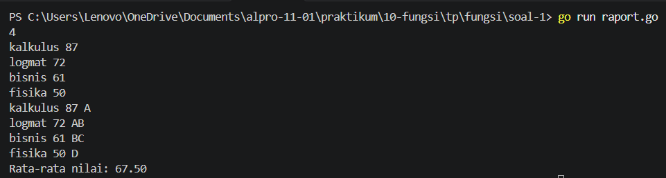
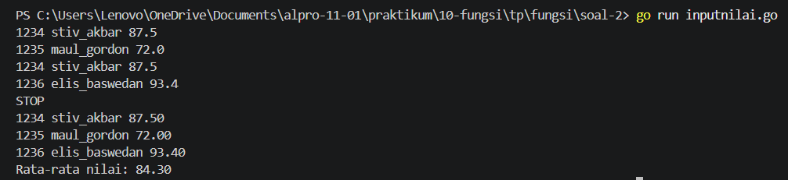
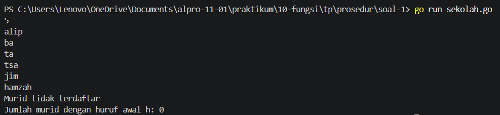
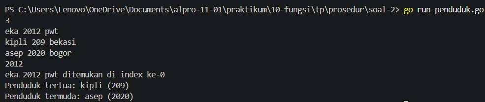

# <h1 align="center">Tugas Pendahuluan Modul 10-11 - Fungsi dan Prosedur </h1>
<p align="center">[Yahya al wahab] - [109092600004]</p>

## Modul - 10 - Fungsi
### 1. raport.go
```go
package main

import "fmt"

const NMAX = 999

type rapot struct {
    matkul string
    nilai  int
}

type tabRapot [NMAX]rapot

// Fungsi menentukan nilai huruf
func nilaiHuruf(x int) string {
    if x > 80 {
        return "A"
    } else if x > 70 {
        return "AB"
    } else if x > 65 {
        return "B"
    } else if x > 60 {
        return "BC"
    } else if x > 50 {
        return "C"
    } else if x > 40 {
        return "D"
    } else {
        return "E"
    }
}

// Fungsi menghitung rata-rata
func rataRata(T tabRapot, n int) float64 {
    total := 0

    for i := 0; i < n; i++ {
        total += T[i].nilai
    }

    return float64(total) / float64(n)
}

func main() {
    var T tabRapot
    var n int

    fmt.Scan(&n)

    // Input data mata kuliah
    for i := 0; i < n; i++ {
        fmt.Scan(&T[i].matkul, &T[i].nilai)
    }

    // Menampilkan hasil
    for i := 0; i < n; i++ {
        fmt.Println(T[i].matkul, T[i].nilai, nilaiHuruf(T[i].nilai))
    }

    fmt.Printf("Rata-rata nilai: %.2f\n", rataRata(T, n))
}
```
##### Output


#### Deskripsi
Program `raport.go` digunakan untuk mengolah data nilai mata kuliah mahasiswa yang terdiri dari nama mata kuliah dan nilai angka. Program ini menggunakan struct dan array untuk menyimpan data, serta fungsi `nilaiHuruf()` untuk mengubah nilai angka menjadi nilai huruf `(A, AB, B, BC, C, D, E)`. Selain itu, `fungsi rataRata()` digunakan untuk menghitung rata-rata seluruh nilai mata kuliah mahasiswa.

### 2. inputnilai.go

```go
package main

import "fmt"

const NMAX = 100

type student struct {
    nim   string
    name  string
    grade float64
}

type students [NMAX]student

// Fungsi mencari NIM
func cariNIM(T students, n int, nim string) int {
    for i := 0; i < n; i++ {
        if T[i].nim == nim {
            return i
        }
    }
    return -1
}

// Fungsi menghitung rata-rata
func rataRata(T students, n int) float64 {
    if n == 0 {
        return 0
    }

    total := 0.0

    for i := 0; i < n; i++ {
        total += T[i].grade
    }

    return total / float64(n)
}

func main() {
    var T students
    var n int

    var nim, nama string
    var nilai float64

    n = 0

    // Input data mahasiswa
    for {
        fmt.Scan(&nim)

        if nim == "STOP" {
            break
        }

        fmt.Scan(&nama, &nilai)

        // Memeriksa apakah NIM sudah ada
        if cariNIM(T, n, nim) == -1 {
            T[n].nim = nim
            T[n].name = nama
            T[n].grade = nilai
            n++
        }
    }

    // Menampilkan data mahasiswa yang sudah bersih
    for i := 0; i < n; i++ {
        fmt.Printf("%s %s %.2f\n",
            T[i].nim, T[i].name, T[i].grade)
    }

    fmt.Printf("Rata-rata nilai: %.2f\n", rataRata(T, n))
}
```

##### Output
<!-- Path relatif dari readme.md ke folder unguided/[nama_soal]/output.png, contoh: -->



#### Deskripsi
Program `inputnilai.go` digunakan untuk memasukkan dan mengolah data nilai mahasiswa berdasarkan NIM, nama, dan nilai ujian. Program ini menggunakan fungsi `cariNIM()` untuk memeriksa apakah NIM sudah pernah dimasukkan sehingga tidak terjadi data duplikat. Data mahasiswa yang memiliki NIM sama hanya disimpan satu kali. Selanjutnya, `fungsi rataRata()` digunakan untuk menghitung rata-rata nilai mahasiswa yang sudah tersimpan tanpa data duplikat.

## Kesimpulan
Kesimpulannya bahwa fungsi dalam bahasa Go digunakan untuk membagi program menjadi beberapa bagian agar kode lebih terstruktur, rapi, dan mudah dipahami. Melalui program `raport.go` dan `inputnilai.go`, saya mempelajari cara membuat dan menggunakan fungsi untuk mengubah nilai angka menjadi nilai huruf, menghitung rata-rata, serta mencari dan memeriksa data mahasiswa agar tidak terjadi duplikasi. Dengan menggunakan fungsi, proses pengolahan data menjadi lebih mudah dan efisien.

## Modul - 11 - Prosedur
### 1. sekolah.go

```go
package main

import "fmt"

const NMAX = 1001

type tabMurid [NMAX]string

// Prosedur mencari nama murid
func cariMurid(T tabMurid, n int, nama string, posisi *int, ketemu *bool) {
    *ketemu = false
    *posisi = 0

    for i := 0; i < n; i++ {
        if T[i] == nama {
            *ketemu = true
            *posisi = i + 1
            return
        }
    }
}

// Prosedur menghitung huruf awal
func hitungHuruf(T tabMurid, n int, h byte, jumlah *int) {
    *jumlah = 0

    for i := 0; i < n; i++ {
        if T[i][0] == h {
            *jumlah++
        }
    }
}

func main() {
    var T tabMurid
    var n int
    var nama string
    var posisi, jumlah int
    var ketemu bool

    // Input jumlah murid
    fmt.Scan(&n)

    // Input nama murid
    for i := 0; i < n; i++ {
        fmt.Scan(&T[i])
    }

    // Input nama yang dicari
    fmt.Scan(&nama)

    // Memanggil prosedur
    cariMurid(T, n, nama, &posisi, &ketemu)

    huruf := nama[0]
    hitungHuruf(T, n, huruf, &jumlah)

    // Menampilkan hasil
    if ketemu {
        fmt.Printf("Murid terdaftar dan berada di urutan ke-%d\n", posisi)
    } else {
        fmt.Println("Murid tidak terdaftar")
    }

    fmt.Printf("Jumlah murid dengan huruf awal %c: %d\n", huruf, jumlah)
}
```

##### Output
<!-- Path relatif dari readme.md ke folder unguided/[nama_soal]/output.png, contoh: -->



#### Deskripsi
Program `sekolah.go` digunakan untuk mengelola data nama murid dalam sebuah kelompok atau daftar sekolah. Program ini dapat mencari nama murid yang dimasukkan dan menentukan urutan posisi murid tersebut dalam array. Selain itu, program juga dapat menghitung jumlah murid berdasarkan huruf awal nama yang dicari. Program ini menggunakan konsep array, prosedur, perulangan, dan percabangan dalam bahasa Go.
### 2. penduduk.go

```go
package main

import "fmt"

const NMAX = 1000

type penduduk struct {
    nama  string
    tahun int
    kota  string
}

type tabPenduduk [NMAX]penduduk

// Prosedur mencari tahun lahir
func cariTahun(T tabPenduduk, n, th int) int {
    for i := 0; i < n; i++ {
        if T[i].tahun == th {
            return i
        }
    }
    return -1
}

// Prosedur mencari penduduk tertua dan termuda
func tertuaTermuda(T tabPenduduk, n int, tua, muda *penduduk) {
    *tua = T[0]
    *muda = T[0]

    for i := 1; i < n; i++ {
        if T[i].tahun < tua.tahun {
            *tua = T[i]
        }

        if T[i].tahun > muda.tahun {
            *muda = T[i]
        }
    }
}

func main() {
    var T tabPenduduk
    var n, th, idx int
    var tua, muda penduduk

    // Input jumlah penduduk
    fmt.Scan(&n)

    // Input data penduduk
    for i := 0; i < n; i++ {
        fmt.Scan(&T[i].nama, &T[i].tahun, &T[i].kota)
    }

    // Input tahun yang dicari
    fmt.Scan(&th)

    // Mencari tahun lahir
    idx = cariTahun(T, n, th)

    if idx != -1 {
        fmt.Printf("%s %d %s ditemukan di index ke-%d\n",
            T[idx].nama, T[idx].tahun, T[idx].kota, idx)
    } else {
        fmt.Println("Data tidak ditemukan")
    }

    // Mencari penduduk tertua dan termuda
    tertuaTermuda(T, n, &tua, &muda)

    fmt.Printf("Penduduk tertua: %s (%d)\n", tua.nama, tua.tahun)
    fmt.Printf("Penduduk termuda: %s (%d)\n", muda.nama, muda.tahun)
}
```

##### Output
<!-- Path relatif dari readme.md ke folder unguided/[nama_soal]/output.png, contoh: -->



#### Deskripsi
Program `penduduk.go` digunakan untuk mengelola data penduduk yang terdiri dari nama, tahun lahir, dan kota asal. Program ini memiliki prosedur `cariTahun()` untuk mencari penduduk berdasarkan tahun lahir serta prosedur `tertuaTermuda()` untuk menentukan penduduk tertua dan termuda berdasarkan tahun kelahiran. Program ini menggunakan konsep struct, array, prosedur, perulangan, dan percabangan dalam bahasa Go.

## Kesimpulan
Berdasarkan praktikum Modul Prosedur, dapat disimpulkan bahwa prosedur dalam bahasa Go digunakan untuk membagi program menjadi beberapa bagian berdasarkan tugasnya sehingga kode lebih terstruktur dan mudah dipahami. Melalui program `sekolah.go` dan `penduduk.go`, saya mempelajari cara menggunakan prosedur untuk mencari nama murid, menghitung jumlah murid berdasarkan huruf awal, mencari penduduk berdasarkan tahun lahir, serta menentukan penduduk tertua dan termuda. Dengan menggunakan prosedur, program menjadi lebih terorganisir dan memudahkan proses pengolahan data.